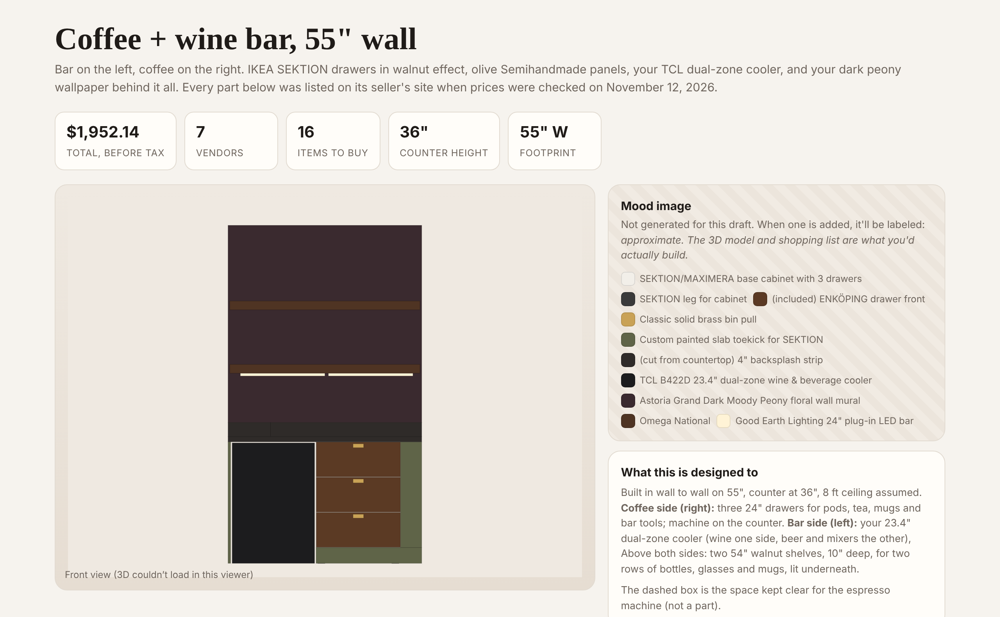
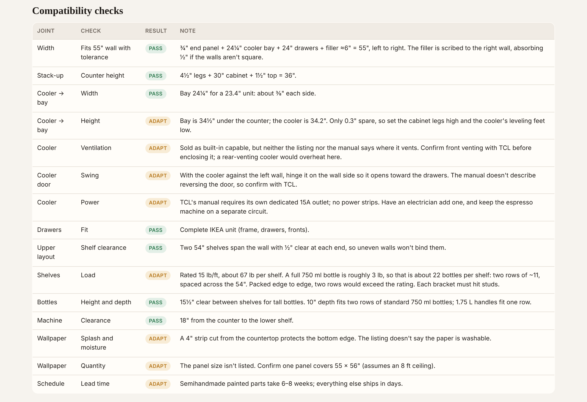
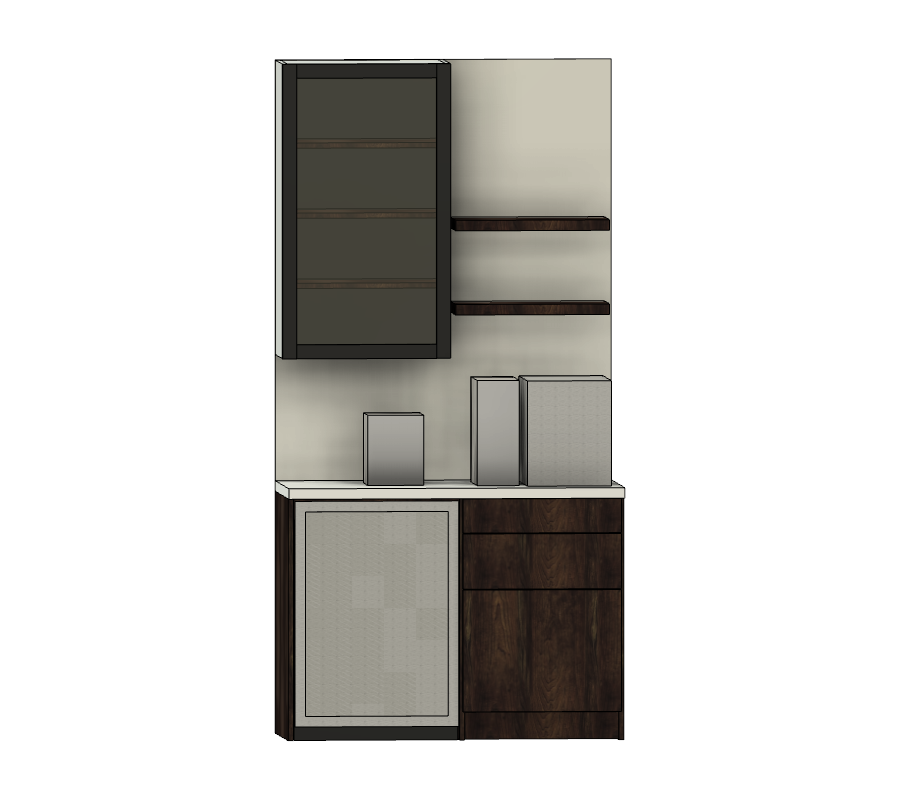
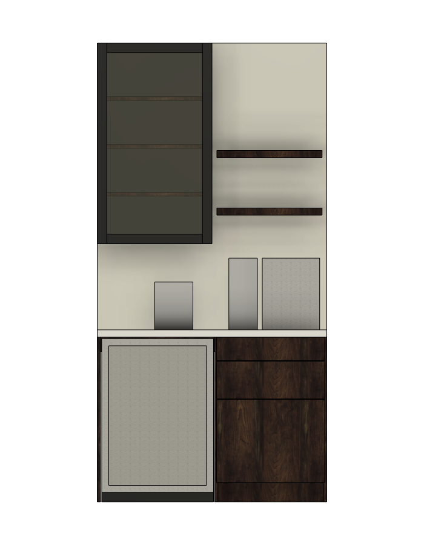

# Composable Furniture — a Claude skill

Design furniture the way an architect designs a building: start from a structure you don't redesign (IKEA frames), add a skin that gives it character (IKEA-compatible fronts, panels, legs and tops from other makers), then fixtures, hardware, finishes, appliances and services from wherever they're sold.

The skill's job isn't suggesting products. It produces a build that **fits together, is still for sale, and matches its render**:

- Eight layers: structure, skin, surface, fixtures, hardware, finish, appliances, services
- Every part is graded on fit: native, certified, adaptable, independent (unverified parts are never used)
- Fit checks: dimension stack-ups, wall tolerance, load, anchoring, appliance ventilation and power
- One `build.json` drives the 3D render, the shopping list, the cut list and the landed cost, so they can't disagree
- A built-in library of known fit rules (IKEA BESTÅ and SEKTION, Semihandmade, Fronteriors, Pretty Pegs, built-in coolers) that grows with every build

Every build comes with fit checks that show what passes and what needs attention before you buy:

## Install

Copy the `composable-furniture` folder into your skills directory:

- **Claude Code:** `~/.claude/skills/composable-furniture/SKILL.md`
- **Claude apps:** upload the folder as a skill in Settings

Then ask for something like *"Design a 48-inch built-in coffee bar with a beverage fridge"* or *"Two-drawer nightstands with brass handles and a hidden phone charger."*

## Example

`examples/coffee-wine-bar/` holds a complete build: a 55" built-in coffee and wine bar (IKEA SEKTION drawers, Semihandmade olive panels, a dual-zone cooler, walnut shelves for two rows of bottles, and wallpaper). Open `index.html` in a browser for the 3D model, bill of materials, cost summary, fit checks, cut list and build sequence.

Prices and availability in the example were checked on 2026-11-12 and will drift; the skill re-checks them live on every build.

## Limits

- Prices and stock change; the skill re-verifies every part each time it runs.
- Amazon listings can't be verified through web search, so the skill uses links you paste or a browser.
- Electrical, plumbing and structural work beyond stud anchoring is flagged for a licensed pro.

---

# Woodshop Build Packet — a second skill, for building from lumber

Composable Furniture assembles pieces from parts you buy. **Woodshop Build Packet** is for the pieces you cut yourself. Give it a design from an open Autodesk Fusion model, a description, a sketch or a photo, and it gives back one printable page:

- **Price sheet** with today's store prices, a link to every product, tax and total
- **Blueprints**: front, side, top and exploded views, dimensioned in tape-measure fractions
- **Cut list and cutting diagrams**: every part, and which store board or sheet it comes from
- **Pocket-hole schedule**: jig setting, screw length and which face gets the holes, per joint
- **Step-by-step instructions** in real build order

It is built for a home shop with a miter saw and a Kreg pocket-hole jig, and it plans around three things that ruin lumber:

- **Lumber names lie.** A 2x4 is 1-1/2" x 3-1/2". Every dimension uses the real size.
- **The space is not the part.** Part lengths are derived from what they sit between, then proven with a check that the parts add up to the finished size.
- **The blade eats 1/8".** Two 48" parts do not come out of one 8-foot board.

A small script inside the skill does this arithmetic, so the cut list, board count and totals are computed and checked instead of estimated. It also flags any cut your tools can't make, such as ripping a board narrower without a table saw. Prices are looked up live on every run; if one can't be found, the sheet says so and links to the product instead of guessing.

## Install

Copy the `woodshop-build-packet` folder into your skills directory:

- **Claude Code:** `~/.claude/skills/woodshop-build-packet/SKILL.md`
- **Claude apps:** upload the folder as a skill in Settings

Then ask for something like *"Make a build packet for a 48-inch entry bench from 2x4s"* or, with a design open in Fusion, *"Make a build packet for this."*

To read designs straight from Fusion, add the Autodesk Fusion connector in the Claude desktop app and turn on the Fusion MCP Server in Fusion's preferences. Fusion and Claude need to run on the same computer. The skill also works without Fusion, from a description.

## Example

`examples/woodshop-coffee-bar/` holds a complete packet: a 48" coffee and bar cabinet in walnut with a built-in dual-zone cooler, a three-drawer coffee stack, a glass upper cabinet and floating shelves, taken from a Fusion model. Open `index.html` in a browser for the drawings, cut list, materials and hardware with links, cost estimate, assembly and install steps.

Prices in the example were checked on 2026-11-13 and will drift; the skill re-checks them on every run.

## Limits

- Prices and stock change, and store sites sometimes hide prices from search. Unpriced items are marked, not guessed.
- The default tool profile is a miter saw and pocket-hole jig. Tell the skill what else you own (table saw, track saw, router) and it will plan with it. The example cabinet uses sheet goods and needs more than the default tools.
- Reading from Fusion needs the Claude desktop app; it can't be done from a browser chat.
- Electrical work, stone tops and glass are flagged for a pro or a fabricator.

---

## License

MIT. See [LICENSE](LICENSE).
